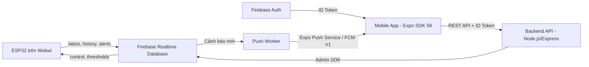

# Seafood Smart — Hệ thống giám sát trang tại thủy sản thông minh

Hệ thống IoT + Backend API + Ứng dụng di động giúp giám sát thông số môi trường ao nuôi theo thời gian thực (**Nhiệt độ, pH, Oxy hòa tan DO, Độ đục, Mực nước**), điều khiển thiết bị từ xa (**Bơm, Oxy, Cho ăn**), thiết lập ngưỡng cảnh báo động và gửi **thông báo đẩy (Push Notifications)** về thiết bị Android.



---

## 1. Cấu trúc dự án

```text
Seafood_Smart_app/
├── .github/workflows/ci.yml   # GitHub Actions CI/CD (typecheck, test, Docker build)
├── backend/                   # Node.js 24 + Express + TypeScript + Firebase Admin + Push Worker
├── mobile/                    # React Native + Expo SDK 58 + TypeScript + Firebase Auth
├── firmware/                  # Mã nguồn ESP32 (chạy mô phỏng trên Wokwi)
└── docs/                      # Tài liệu kiến trúc, kế hoạch giao diện và kiểm thử
```

---

## 2. Yêu cầu môi trường

| Công cụ | Phiên bản / Ghi chú |
| :--- | :--- |
| **Node.js & npm** | Node.js `>= 24.12.0` (kiểm tra bằng `node -v`) |
| **Git** | Phiên bản mới nhất |
| **Firebase Project** | Đã bật **Authentication (Email/Password)** và **Realtime Database** |
| **Tài khoản Expo (EAS)** | Dùng để liên kết `projectId`, nạp khóa **FCM V1** và build Development Build |
| **Android Emulator / Điện thoại Android** | Máy ảo Android API 35 có **Google Play Services** (hoặc điện thoại Android thật) |
| **Wokwi** | Chạy mô phỏng mạch ESP32 với mã trong `firmware/` |

---

## 3. Hướng dẫn cài đặt môi trường từ đầu

### Bước 1: Clone dự án
```bash
git clone https://github.com/truonga-dev/Seafood_Smart.git
cd Seafood_Smart
```

### Bước 2: Cài đặt & cấu hình Backend
```bash
cd backend
npm ci
```

1. Tải file khóa **Firebase Service Account JSON** từ *Firebase Console → Project Settings → Service accounts → Generate new private key* và lưu ở đường dẫn cục bộ (không commit lên Git).
2. Sao chép file mẫu `backend/.env.example` thành `backend/.env` và điền thông tin:
   ```dotenv
   PORT=3000
   FIREBASE_DATABASE_URL=https://seafood-smart-default-rtdb.asia-southeast1.firebasedatabase.app
   GOOGLE_CLOUD_PROJECT=seafood-smart
   GOOGLE_APPLICATION_CREDENTIALS=E:/duong-dan-toi/firebase-adminsdk.json
   CORS_ORIGINS=
   PUSH_PONDS=pond01
   ```
3. Kiểm tra kết nối Firebase, biên dịch và chạy test:
   ```bash
   npm run check
   npm test
   npm run check:firebase
   ```
   Nếu thấy `Connected to Firebase; /ponds/pond01/info is available.` là Backend đã sẵn sàng.

### Bước 3: Cài đặt & cấu hình Mobile (Expo SDK 58)
```bash
cd ../mobile
npm ci
```

1. Kiểm tra địa chỉ **IPv4 LAN** của máy tính đang chạy Backend:
   ```bat
   ipconfig
   ```
   *(Ví dụ: `192.168.1.4` — điện thoại/máy ảo cần gọi IP LAN thay vì `localhost`).*
2. Sao chép `mobile/.env.example` thành `mobile/.env` và điền cấu hình Firebase Web (từ *Firebase Console → Project Settings → Your apps*) cùng `EXPO_PUBLIC_EAS_PROJECT_ID`:
   ```dotenv
   EXPO_PUBLIC_API_BASE_URL=http://192.168.1.4:3000/api/v1
   EXPO_PUBLIC_FIREBASE_API_KEY=<firebase_web_api_key>
   EXPO_PUBLIC_FIREBASE_AUTH_DOMAIN=seafood-smart.firebaseapp.com
   EXPO_PUBLIC_FIREBASE_PROJECT_ID=seafood-smart
   EXPO_PUBLIC_FIREBASE_APP_ID=<firebase_web_app_id>
   EXPO_PUBLIC_EAS_PROJECT_ID=<eas_project_uuid>
   ```
3. Đặt file `google-services.json` (tải từ Firebase Android app có package `com.seafoodsmart.app`) vào thư mục `mobile/`.
4. Kiểm tra TypeScript và test của Mobile:
   ```bash
   npm run check
   npm test
   ```

### Bước 4: Thiết lập EAS & thông báo đẩy Android (FCM V1)
> **Lưu ý**: **Expo Go** (từ SDK 53 trở lên) **không hỗ trợ remote push notifications**. Để thử thông báo đẩy trên Android, bắt buộc dùng **Development Build** (`com.seafoodsmart.app`).

1. Đăng nhập tài khoản Expo và liên kết dự án EAS tại thư mục `mobile`:
   ```bat
   npx -y eas-cli@latest login
   npx -y eas-cli@latest init
   ```
   Cập nhật UUID `extra.eas.projectId` vừa tạo vào `EXPO_PUBLIC_EAS_PROJECT_ID` trong `mobile/.env`.
2. Nạp khóa **FCM V1** (dùng file Firebase Service Account JSON ở Bước 2):
   ```bat
   npx -y eas-cli@latest credentials --platform android
   ```
   Chọn lần lượt: `development` → **Google Service Account** → **Manage your Google Service Account Key for Push Notifications (FCM V1)** → **Upload a new service account key** → nhập đường dẫn tới file JSON.
3. Tạo file APK Development Build (nếu chưa có sẵn APK) và cài lên máy ảo / điện thoại Android:
   ```bat
   npx -y eas-cli@latest build --platform android --profile development
   ```
   Sau khi tải file `.apk`, cài lên máy ảo bằng:
   ```bat
   adb install -r duong-dan-toi/seafood-smart-development.apk
   ```

### Bước 5: Chuẩn bị Firmware ESP32 trên Wokwi
1. Mở dự án mô phỏng ESP32 trên **Wokwi**.
2. Nạp mã từ `firmware/firmware.ino` và `firmware/config.h` (cấu hình đúng URL Firebase Realtime Database của dự án).
3. Nhấn **Start Simulation** và chờ Serial Monitor báo `[WiFi] Da ket noi toi AP`.

---

## 4. Hướng dẫn chạy toàn bộ hệ thống (Windows CMD)

Mở **4 cửa sổ Command Prompt (`cmd`)** riêng biệt và chạy theo thứ tự sau:

### Cửa sổ 1 — Backend API (cổng 3000)
```bat
cd /d E:\STUDY\LapTrinhDiDong2\Project\Seafood_Smart_app\backend
npm run dev
```
* Kiểm tra hoạt động: mở `http://localhost:3000/health` (trả về `{"status":"ok"}`) và tài liệu Swagger tại `http://localhost:3000/api/docs`.

### Cửa sổ 2 — Push Worker (gửi thông báo đẩy cho `pond01`)
```bat
cd /d E:\STUDY\LapTrinhDiDong2\Project\Seafood_Smart_app\backend
npm run build
npm run worker
```
* Khi hiện `Expo push worker started for pond01` là worker đang lắng nghe cảnh báo mới (chỉ chạy **1 worker** cho mỗi ao).

### Cửa sổ 3 — Máy ảo Android (`SeafoodSmart_API35`)
```bat
cd /d E:\STUDY\LapTrinhDiDong2\Project\Seafood_Smart_app\mobile
powershell -ExecutionPolicy Bypass -File .\android-emulator.ps1
```
* Chờ máy ảo khởi động vào hẳn màn hình chính (không chạy 2 bản máy ảo cùng lúc).

### Cửa sổ 4 — Frontend (Expo Dev Client) & kết nối máy ảo Android
```bat
cd /d E:\STUDY\LapTrinhDiDong2\Project\Seafood_Smart_app\mobile
set ANDROID_HOME=E:\STUDY\LapTrinhDiDong2\Project\Seafood_Smart_app\.android-sdk
set PATH=%ANDROID_HOME%\platform-tools;%PATH%
adb reverse tcp:8081 tcp:8081
npx expo start --dev-client --android
```

---

## 5. Cách kiểm thử thông báo đẩy (Push Notifications)

1. Mở app **Seafood Smart** (`com.seafoodsmart.app`) trên máy ảo Android và đăng nhập bằng tài khoản Firebase đã được cấp quyền trong `pondMembers` (`owner` hoặc `viewer`).
2. Vào tab **Cài đặt → Thông báo đẩy → Bật thông báo** và bấm **Allow (Cho phép)** quyền thông báo.
3. Chỉnh cảm biến trên **Wokwi** vượt ngưỡng (ví dụ kéo nhiệt độ `DS18B20` lên `> 32°C` hoặc giảm biến trở `DO`), hoặc chạy lệnh bắn cảnh báo mẫu từ `backend`:
   ```bat
   cd /d E:\STUDY\LapTrinhDiDong2\Project\Seafood_Smart_app\backend
   node --input-type=module -e "import { database } from './dist/firebase.js'; await database.ref('ponds/pond01/alerts').push({ ts: Date.now(), temp: 36.5, ph: 7.2, do: 2.0, turbidity: 18, waterLevel: 75, types: ['Oxy hòa tan thấp', 'Nhiệt độ nước quá cao'], message: 'Cảnh báo: Nhiệt độ 36.5°C, DO thấp 2.0 mg/L' }); console.log('Da gui canh bao test'); process.exit(0);"
   ```
4. Sau khoảng **5–10 giây**, kéo thanh trạng thái từ mép trên màn hình máy ảo Android xuống để xem thông báo **"Cảnh báo ao nuôi"**.

---

## 6. Kiểm thử, Docker & CI/CD

### Chạy kiểm tra cục bộ
```bash
# Backend: kiểm tra TypeScript, build và chạy 11 test
cd backend && npm run check && npm test

# Mobile: kiểm tra TypeScript và chạy 3 unit test
cd mobile && npm run check && npm test

# Build Docker image cho Backend
docker build -t seafood-smart-backend ./backend
```

### GitHub Actions CI/CD
Workflow [.github/workflows/ci.yml](.github/workflows/ci.yml) tự động chạy trên mỗi lần `push` và `pull_request` vào nhánh `main`:
1. **`Backend Check & Test`**: cài đặt (`npm ci`), kiểm tra kiểu (`npm run check`), build và chạy toàn bộ test (`npm test`).
2. **`Mobile Check & Test`**: cài đặt (`npm ci`), kiểm tra kiểu (`npm run check`), chạy unit test (`npm test`).
3. **`Backend Docker Image Build`**: kiểm tra đóng gói container từ `backend/Dockerfile`.

---

## 7. Xử lý lỗi thường gặp

* **Đổi mạng WiFi làm app không gọi được API**: Chạy `ipconfig`, cập nhật IPv4 mới vào `EXPO_PUBLIC_API_BASE_URL` trong `mobile/.env`, rồi khởi động lại Expo bằng `npx expo start --dev-client --clear`.
* **Expo Go báo không hỗ trợ thông báo đẩy**: Chuyển sang chạy trên **Development Build** (`com.seafoodsmart.app`) ở máy ảo Android hoặc cài APK lên điện thoại Android thật.
* **Push Worker báo lỗi `InvalidCredentials`**: Chưa nạp khóa FCM V1 lên dự án EAS ứng với `EXPO_PUBLIC_EAS_PROJECT_ID` đang dùng — thực hiện lại **Bước 4.2**, khởi động lại Metro và bấm **Bật thông báo** lại trong app.
* **Máy ảo Android bị treo ở màn hình khởi động**: Đảm bảo cấu hình AVD bật GPU (`hw.gpu.enabled=yes`), RAM tối thiểu `3G`, `vm.heapSize=256M`, hoặc chạy khởi động sạch một lần với cờ `-wipe-data`.

---

## 8. Tài liệu chi tiết

* [Tài liệu phát triển hệ thống](docs/DEVELOPMENT.md)
* [Kế hoạch giao diện & kiểm thử](docs/KE_HOACH_GIAO_DIEN.md)
* [Tài liệu Backend](backend/README.md)
* [Tài liệu Mobile & Push Notifications](mobile/README.md)
