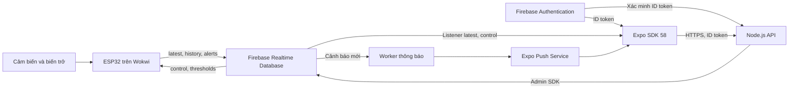

# Tài liệu phát triển Seafood Smart

Tài liệu này mô tả kế hoạch xây dựng Lab 2 và Lab 3 cho hệ thống giám sát ao nuôi. Backend MVP và worker thông báo đã được khởi tạo trong `backend/`; ứng dụng Expo chưa được tạo. Xem `backend/README.md` để biết cách chạy và các giới hạn kiểm thử.

## 1. Mục tiêu và phạm vi

- Lab 1 là ESP32 mô phỏng trên Wokwi. Thiết bị đọc cảm biến, tự điều khiển và trao đổi dữ liệu qua Firebase Realtime Database.
- Lab 2 cung cấp API xác thực, phân quyền, lịch sử, cảnh báo, điều khiển, ngưỡng và thông báo đẩy.
- Lab 3 là ứng dụng React Native + Expo, sử dụng Expo SDK 58 và TypeScript.
- MVP dùng ao `pond01`, có vai trò chủ ao và người xem. Các đường dẫn sử dụng `pondId` để có thể mở rộng sau.
- Giá trị pH, DO và độ đục đang được mô phỏng bằng biến trở. DS18B20 và HC-SR04 được mô phỏng theo cấu hình phần cứng của Lab 1.

Database đã cung cấp: `https://seafood-smart-default-rtdb.asia-southeast1.firebasedatabase.app/`. Chưa truy cập trực tiếp được dữ liệu hoặc rules từ môi trường viết tài liệu.

Firebase Rules hiện cấp `.read: true` và `.write: true` tại gốc. Đã bổ sung `.indexOn` cho `ts` tại `history` và `alerts` của mỗi ao, đồng thời giữ quyền gốc hiện tại. Truy vấn history và alerts của `pond01` đã được kiểm tra thành công. Rules vẫn đang mở công khai, cần thiết kế xác thực ESP32 trước khi giới hạn quyền.

Chế độ demo của firmware vẫn gửi yêu cầu ẩn danh khi `DATABASE_SECRET` để rỗng. Bản cục bộ bổ sung chế độ Firebase Auth tùy chọn cho tài khoản thiết bị, sử dụng ID token và kiểm tra chứng chỉ TLS; xem hướng dẫn cấu hình trong `backend/README.md`. Chế độ này cần được kiểm thử thực tế cùng Rules dự thảo trước khi giới hạn quyền ghi. URL cơ sở trong cấu hình cục bộ đã được bỏ dấu `/` cuối.

Thư mục `firmware/` chứa bản điều chỉnh cục bộ từ mã nhóm cung cấp. Bản này kiểm tra DO trong `feedFish` cho mọi nguồn, ghi nhận lệnh app đã xử lý trong RAM để thử lại thao tác xóa cờ mà không cho ăn lặp trong cùng lần chạy, và bỏ dấu `/` cuối của URL. Cần chép hai file vào Wokwi và kiểm thử trước khi dùng. Nếu ESP32 khởi động lại trước khi cờ được xóa, trạng thái RAM bị mất và lệnh cũ vẫn có thể được thực hiện lại; hợp đồng `feedNow` dạng boolean chưa xác nhận duy nhất từng lệnh.

## 2. Kiến trúc đề xuất

Firebase giống cuốn sổ chung của ao. ESP32 ghi số liệu và đọc lệnh từ sổ. Ứng dụng theo dõi các trang realtime. Backend kiểm tra quyền trước khi ghi lệnh và tính toán lịch sử để ứng dụng hiển thị.



Stack đề xuất gồm Node.js + Express + TypeScript, Firebase Admin SDK, Firebase Authentication, Expo Router, TanStack Query và Firebase JavaScript SDK. API xử lý các thao tác ghi của app. Firebase listener cấp dữ liệu realtime cho người có quyền xem ao. Backend và Firebase Rules cùng kiểm tra quyền theo ao.

Hướng này là quyết định kỹ thuật đề xuất. Nhóm có thể thay Node.js bằng Spring Boot nếu giảng viên yêu cầu, đồng thời giữ nguyên hợp đồng thiết bị.

## 3. Công cụ và phiên bản

| Thành phần | Lựa chọn |
|---|---|
| Mobile | Expo SDK 58, React Native và TypeScript |
| Routing | Expo Router |
| Dữ liệu API | TanStack Query |
| Realtime | Firebase JavaScript SDK, Realtime Database listener |
| Đăng nhập | Firebase Authentication |
| Backend | Node.js, Express, TypeScript, Firebase Admin SDK |
| Thông báo | `expo-notifications`, Expo Push Service |
| Biểu đồ | Chọn thư viện tương thích SDK 58 sau khi kiểm tra và thử trên development build |

Expo ghi SDK 58 tương ứng React Native 0.88, React 19.3.0 và Node.js tối thiểu 22.13.x. Backend hiện yêu cầu Node.js 24.12 trở lên theo các phiên bản Firebase trong `package-lock.json`. Dùng `npx expo install` cho gói Expo/React Native để chọn phiên bản tương thích. [Tài liệu Expo SDK 58](https://docs.expo.dev/versions/v58.0.0/)

## 4. Khởi tạo workspace

Cấu trúc dự kiến:

```text
Seafood_Smart_app/
├── docs/
│   └── DEVELOPMENT.md
├── mobile/                 # Expo Router, UI và Firebase client
│   ├── app/                # Các route và layout
│   ├── src/                # Components, features, services, types
│   ├── .env.example
│   └── package.json
└── backend/                # API, xác thực và truy cập Firebase Admin
    ├── src/
    ├── .env.example
    └── package.json
```

Tạo app từ thư mục gốc bằng công cụ Expo, chọn template SDK 58 và xác nhận `mobile/package.json` có `expo` thuộc dòng `^58.0.0`:

```powershell
npx create-expo-app@latest mobile --template default@sdk-58
cd mobile
npx expo install --fix
npx expo-doctor
npx expo start
```

Lệnh trên dùng để khởi tạo dự án mới. Nếu CLI không cung cấp lựa chọn template phù hợp, làm theo tài liệu `create-expo-app` hiện hành và xác minh phiên bản trước khi phát triển. Với điện thoại thật, máy tính và điện thoại cần kết nối mạng cho phép truy cập Metro. Để gọi API cục bộ từ điện thoại, cấu hình địa chỉ IP LAN của máy chạy API, không dùng `localhost` của điện thoại.

Backend đã có `package.json` và các lệnh `npm run dev`, `npm run check`, `npm run build` và `npm start`. Cần cấu hình Firebase Admin và quyền theo hướng dẫn trong `backend/README.md` trước khi kiểm thử API.

## 5. Cấu hình môi trường

Ví dụ giá trị cấu hình dự kiến cho `mobile/.env.example`:

```dotenv
EXPO_PUBLIC_API_BASE_URL=http://<LAN_IP>:3000/api/v1
EXPO_PUBLIC_FIREBASE_API_KEY=<firebase_web_api_key>
EXPO_PUBLIC_FIREBASE_AUTH_DOMAIN=<firebase_auth_domain>
EXPO_PUBLIC_FIREBASE_PROJECT_ID=<firebase_project_id>
EXPO_PUBLIC_FIREBASE_DATABASE_URL=https://seafood-smart-default-rtdb.asia-southeast1.firebasedatabase.app/
EXPO_PUBLIC_FIREBASE_APP_ID=<firebase_app_id>
```

Các biến `EXPO_PUBLIC_*` được đưa vào app và có thể bị người dùng đọc. Firebase web config dùng để định danh dự án, còn quyền truy cập phải được bảo vệ bằng Auth và Rules. Không đặt database secret, service account hoặc khóa riêng trong app. [Expo environment variables](https://docs.expo.dev/guides/environment-variables/)

Ví dụ cấu hình dự kiến cho `backend/.env.example`:

```dotenv
PORT=3000
FIREBASE_DATABASE_URL=https://seafood-smart-default-rtdb.asia-southeast1.firebasedatabase.app/
GOOGLE_APPLICATION_CREDENTIALS=<duong_dan_service_account_cuc_bo>
```

Ở môi trường cloud, ưu tiên danh tính service account do nền tảng cấp nếu hỗ trợ. File service account chỉ sử dụng trên server, lưu ngoài source control. Không commit `.env`, database secret hoặc khóa riêng. Chỉ commit `.env.example` không có giá trị bí mật.

## 6. Hợp đồng Firebase của ESP32

```text
/ponds/{pondId}/
  info       name, location, firmware, deviceId
  latest     số đo và trạng thái thực tế, ghi đè khoảng 5 giây
  history/   {pushId}, bản ghi cùng cấu trúc latest khoảng 20 giây
  alerts/    {pushId}, thêm khi có cảnh báo mới
  control    mode, pump, aerator, feedNow
  thresholds tempMin, tempMax, phMin, phMax, doOn, doOff,
             turbMax, levelLow, levelHigh
```

`latest` và `history` gồm `temp`, `ph`, `do`, `turbidity`, `waterLevel`, `distance`, `pump`, `aerator`, `mode`, `status`, `alertMask`, `alerts`, `feedCount`, `rssi`, `uptime`, `ts` và `lastFeedSecAgo` khi `feedCount > 0`. `ts` là timestamp máy chủ theo mili giây epoch. Dữ liệu có thể thiếu hoặc chưa được thiết bị ghi, do đó xử lý an toàn giá trị `null`, trường vắng mặt và mảng rỗng khi đọc.

Bit 0–7 của `alertMask` lần lượt biểu thị nhiệt độ cao, nhiệt độ thấp, pH thấp, pH cao, DO thấp, nước đục, mực nước thấp và lỗi cảm biến. Cảnh báo mới gồm `types`, `message`, số đo và `ts`. Không giả định có `resolved` hoặc `acknowledged`.

Lịch sử được truy vấn bằng `orderByChild("ts")`. Đảm bảo rules có chỉ mục `ts` ở nhánh `history`; kiểm tra cả nhánh `alerts` nếu truy vấn cảnh báo theo `ts`. Dùng giới hạn thời gian và phân trang để tránh tải toàn bộ dữ liệu. [Firebase truy vấn dữ liệu](https://firebase.google.com/docs/database/web/lists-of-data#sort_data)

Các nhánh `/pondMembers/{pondId}/{uid}` và `/pushTokens/{uid}/{tokenId}` là đề xuất cho backend, cần thống nhất trước khi tạo. Firebase Authentication quản lý định danh tài khoản. Không thay đổi các trường trong `/ponds` khi chưa đối chiếu firmware.

## 7. Xác thực và phân quyền

1. Người dùng đăng nhập Firebase Authentication trên app.
2. App gửi Firebase ID token qua `Authorization: Bearer <token>` tới backend.
3. Backend xác minh token bằng Firebase Admin SDK và lấy `uid`.
4. Backend kiểm tra quyền của `uid` với `pondId`. `owner` có quyền đọc và điều khiển; `viewer` chỉ đọc.
5. Firebase Rules cũng kiểm tra membership cho listener app. Backend Admin SDK có đặc quyền cao nên mọi API phải tự kiểm tra quyền.

Hiện rules được mô tả là mở cho demo và ESP32 có thể đang dùng `DATABASE_SECRET` hoặc truy cập ẩn danh. Trước khi đóng rules, xác định cơ chế xác thực thực tế của firmware và kiểm thử thiết bị. Thiết kế danh tính riêng cho ESP32 và quyền tối thiểu theo các nhánh cần dùng. Tránh đưa secret vào app. [Firebase Rules và Auth](https://firebase.google.com/docs/database/security/rules-conditions)

## 8. API backend dự kiến

Các endpoint dữ liệu cần xác thực và kiểm tra quyền theo ao. Danh sách sau phản ánh thiết kế và phần API MVP; kiểm tra `/api/docs` để xem đặc tả hiện hành.

| Phương thức | Đường dẫn | Mục đích |
|---|---|---|
| GET | `/api/v1/ponds` | Danh sách ao được phép truy cập |
| GET | `/api/v1/ponds/{pondId}/history?from=&to=&interval=` | Lịch sử theo epoch ms và khoảng gộp `raw`, `hour` hoặc `day` |
| GET | `/api/v1/ponds/{pondId}/alerts?from=&to=&type=` | Danh sách cảnh báo và bộ lọc |
| GET | `/api/v1/ponds/{pondId}/thresholds` | Đọc ngưỡng |
| PATCH | `/api/v1/ponds/{pondId}/thresholds` | Cập nhật các ngưỡng hợp lệ, owner |
| PATCH | `/api/v1/ponds/{pondId}/control` | Gửi lệnh mode, pump, aerator hoặc feedNow, owner |
| POST | `/api/v1/push-tokens` | Đăng ký hoặc cập nhật token thiết bị cho user |
| DELETE | `/api/v1/push-tokens/{tokenId}` | Hủy đăng ký token của user |
| GET | `/health` | Kiểm tra tiến trình và phục vụ warm-up trước demo |
| GET | `/api/docs` | Tài liệu OpenAPI/Swagger |

Xác định giới hạn khoảng truy vấn, số bản ghi, phân trang và múi giờ gộp trong OpenAPI trước khi lập trình. Trả mã lỗi nhất quán cho dữ liệu không hợp lệ, chưa xác thực, không đủ quyền và lỗi dịch vụ. Kiểm thử dữ liệu cũ, `ts` thiếu hoặc không hợp lệ và các khoảng không có bản ghi.

## 9. Quy tắc điều khiển và ngưỡng

### Điều khiển

- Ở `auto`, ESP32 bỏ qua lệnh `pump` và `aerator`, tự quyết định.
- Ở `manual`, thiết bị áp dụng lệnh nhưng vẫn ngắt bơm cưỡng bức khi `waterLevel >= 98%`. App giải thích khi lệnh bật không khớp trạng thái thực tế.
- Sau khi API ghi lệnh, giao diện hiển thị đang chờ cho đến khi `latest.mode`, `latest.pump` hoặc `latest.aerator` khớp. Nếu quá thời gian chờ, hiển thị chưa xác nhận và cho phép kiểm tra lại; không khẳng định lệnh đã thất bại.
- `feedNow = true` kích hoạt cho ăn và ESP32 cố đặt lại `false`. Quan sát `feedCount` tăng để xác nhận cho ăn; nếu thiết bị khởi động lại hoặc nhiều lệnh trùng nhau, cần xử lý trạng thái chưa xác định thay vì khẳng định thành công. Firmware gốc không kiểm tra kết quả PATCH đặt lại `feedNow`. Bản cục bộ có thử lại và giữ trạng thái đã xử lý trong RAM.
- Yêu cầu xác nhận khi chủ ao tắt quạt trong điều kiện DO thấp. Không gửi nhiều yêu cầu cho ăn đồng thời khi lệnh trước chưa xử lý. Firmware gốc chỉ kiểm tra DO trước lịch cho ăn tự động; bản cục bộ đưa kiểm tra vào `feedFish` để áp dụng cả lệnh app và nút vật lý. Cần kiểm thử trên Wokwi.
- Nút vật lý có thể đổi chế độ. Lắng nghe `control` và `latest` thay vì giữ trạng thái cục bộ làm nguồn đúng duy nhất.

### Ngưỡng

Kiểm tra `tempMin < tempMax`, `phMin < phMax`, `doOn < doOff` và `levelLow < levelHigh`. Kiểm tra giá trị số hữu hạn và khoảng hợp lệ theo hợp đồng và firmware. Mặc định đề xuất: `tempMin=25`, `tempMax=32`, `phMin=6.5`, `phMax=8.5`, `doOn=5`, `doOff=6.5`, `turbMax=100`, `levelLow=30`, `levelHigh=85`. App thông báo thiết bị đọc ngưỡng khoảng mỗi 60 giây.

## 10. Màn hình app

| Màn hình | Nội dung chính |
|---|---|
| Đăng nhập / chọn ao | Xác thực, chọn ao được cấp quyền |
| Tổng quan | Năm chỉ số, online/offline, thời gian cập nhật, bơm/quạt và cảnh báo |
| Lịch sử | Chọn chỉ số và 1 giờ, 24 giờ hoặc 7 ngày |
| Điều khiển | Chế độ, bơm, quạt, cho ăn, trạng thái chờ/xác nhận |
| Cảnh báo | Danh sách theo thời gian, lọc loại và thông báo đẩy |
| Cài đặt ngưỡng | Các ngưỡng, kiểm tra hợp lệ, khôi phục mặc định |
| Thông tin | Tên ao, firmware, RSSI, uptime và số lần cho ăn |

Các màn hình cần trạng thái tải, rỗng, lỗi mạng, dữ liệu cũ và thiết bị offline. Đánh dấu cảnh báo bằng nhãn hoặc biểu tượng cùng với màu sắc. Dùng chữ đủ lớn để đọc ngoài trời và hỗ trợ sáng/tối.

Với offline, ước tính thời gian máy chủ bằng `Date.now() + serverTimeOffset` từ `/.info/serverTimeOffset` rồi so sánh với `latest.ts`. Sau khoảng 20 giây dữ liệu không cập nhật thì đánh dấu thiết bị offline. Nếu thiếu offset hoặc mất kết nối của điện thoại, thể hiện trạng thái chưa xác định hoặc dữ liệu cũ, tránh kết luận chắc chắn. [Firebase server time offset](https://firebase.google.com/docs/database/web/offline-capabilities#clock-skew)

## 11. Thông báo đẩy và demo

Push từ xa cần development build. Expo Go không hỗ trợ tính năng này trên Android từ SDK 53; tài liệu Expo khuyến nghị development build để thử push. Cần thiết lập Expo project, `expo-notifications`, quyền thông báo, token, kênh Android và thông tin FCM/APNs theo hướng dẫn nền tảng. [Expo Notifications](https://docs.expo.dev/versions/v58.0.0/sdk/notifications/) · [Expo push setup](https://docs.expo.dev/push-notifications/push-notifications-setup/)

Sau khi đã tạo dự án và cấu hình EAS, luồng Android tham khảo:

```powershell
cd mobile
npx expo install expo-dev-client expo-notifications
npx eas-cli@latest login
npx eas-cli@latest build:configure
npx eas-cli@latest build --platform android --profile development
npx expo start
```

Cấu hình profile `development` có `developmentClient: true` trước khi build. Cài development build lên thiết bị rồi chạy Metro. Cấu hình push credentials cần hoàn thành trước demo. [Expo Android development build](https://docs.expo.dev/tutorial/eas/android-development-build/)

Worker cần nhận sự kiện cảnh báo mới ngay cả khi API miễn phí ngủ. Xác định một dịch vụ luôn hoạt động hoặc cơ chế sự kiện đáng tin cậy trước khi chọn nền tảng triển khai. Khi xử lý lại sự kiện, lưu trạng thái theo `pondId` và `alertId`, kiểm soát retry, xử lý Expo push tickets/receipts và xóa token không còn hợp lệ. Thiết kế tránh thông báo trùng nhưng không tuyên bố đảm bảo giao đúng một lần. Kiểm tra quota và chính sách giá tại thời điểm triển khai.

## 12. Kịch bản kiểm thử end-to-end

1. Đăng nhập chủ ao, chọn `pond01` và xác nhận số đo khớp Firebase.
2. Giảm DO trên Wokwi. Kiểm tra thẻ cảnh báo, quạt thực tế và thông báo đẩy trên development build.
3. Chuyển manual, thử tắt quạt khi DO thấp và xác nhận hộp thoại. Đối chiếu lệnh `control` với `latest`.
4. Bấm cho ăn, kiểm tra servo và `feedCount`. Thử DO quá thấp với từng nguồn lệnh trên bản firmware cục bộ. Kiểm tra lỗi khi thiết bị đặt lại `feedNow` và trường hợp khởi động lại trước khi xóa cờ.
5. Đặt mực nước từ 98%, gửi lệnh bật bơm và kiểm tra chống tràn.
6. Đổi ngưỡng pH, kiểm tra thiết bị đọc lại sau khoảng 60 giây và cảnh báo thay đổi theo ngưỡng.
7. Xem biểu đồ 24 giờ với dữ liệu đã có. Thử cả khoảng rỗng.
8. Dừng Wokwi, chờ quá 20 giây và kiểm tra offline. Ngắt mạng điện thoại để kiểm tra trạng thái dữ liệu cũ.
9. Đăng nhập người xem và xác nhận không thể ghi lệnh hay sửa ngưỡng qua UI, API và Rules.
10. Khởi động lại worker và thử xử lý sự kiện lặp để kiểm tra thông báo trùng và phục hồi.

## 13. Triển khai cloud

Chọn nền tảng có HTTPS, hỗ trợ Node.js và biến môi trường. Tạo service account với quyền phù hợp, đặt `FIREBASE_DATABASE_URL` và cấu hình thông tin đăng nhập server. Triển khai API và worker theo mô hình đã chọn, xác minh `/health`, tài liệu API, Auth, Firebase Rules và push trên thiết bị thật. Nếu nền tảng có cold start, gọi health endpoint trước buổi demo và đo thời gian phản hồi thực tế. Không phụ thuộc warm-up API để đảm bảo worker nhận cảnh báo.

## 14. Tài liệu liên quan

- [Bảng nghiệp vụ, chức năng và database](https://docs.google.com/spreadsheets/d/1n75zAJkjMlQjnxloVwMO7liMz5ZMfcqqSHM7nhmMym8/edit)
- [Thiết kế giao diện Figma](https://www.figma.com/design/jUVlAuJiBQoTohBGX0S1kS)
- [Expo SDK 58](https://docs.expo.dev/versions/v58.0.0/)
- [Firebase Realtime Database REST API](https://firebase.google.com/docs/reference/rest/database/)
- [Firebase Admin SDK](https://firebase.google.com/docs/admin/setup)
